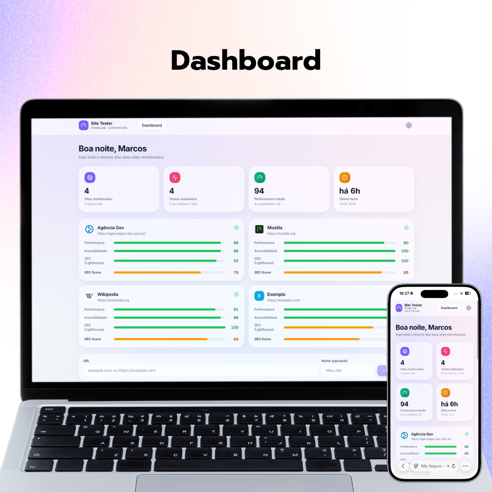
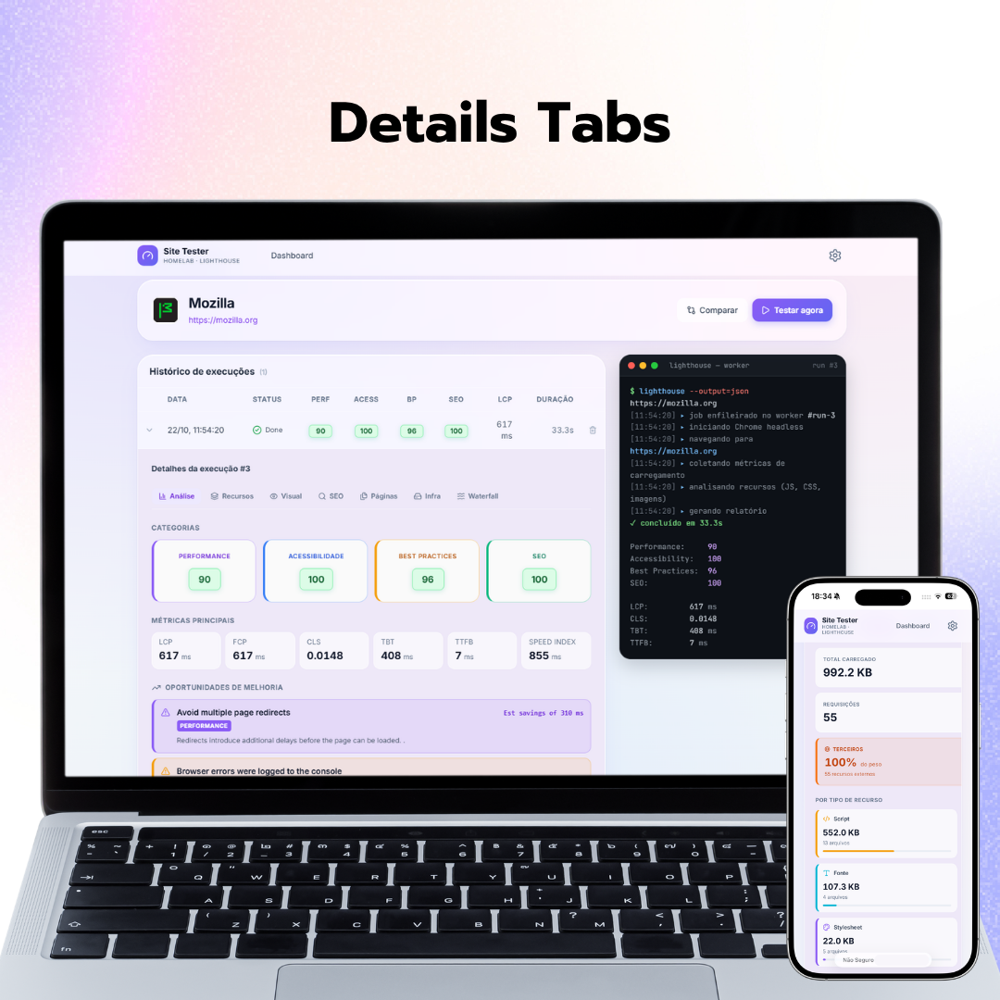
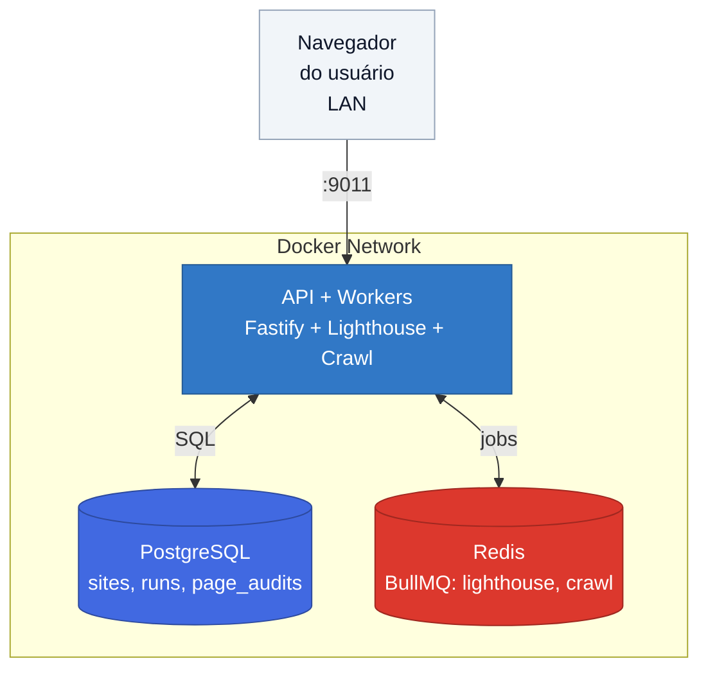

# Site Tester — homelab edition

> **Auditor completo de SEO, performance e infraestrutura de sites.**
> Análise técnica profunda, crawler de múltiplas páginas, detecção de tecnologias e score consolidado.
> Rodando 100% no homelab, sem dependência de APIs pagas.

[]()
[]()
[]()
[]()
[]()
[]()
[]()
[]()
[]()
[]()
[]()

---

## Sobre

Este projeto é um **auditor SEO completo** caseiro, feito para rodar em um servidor doméstico (homelab).

Nasceu da necessidade de acompanhar e diagnosticar a performance de sites sem depender de serviços pagos como GTMetrix, Ahrefs ou SEMrush. O objetivo é entregar **análise acionável** — não apenas números, mas o que está errado, por que, e como corrigir.

Diferente de ferramentas SaaS, ele:

- Roda **inteiramente dentro da minha rede**, sem enviar dados para fora
- Usa o **Lighthouse** oficial do Google para análise de performance
- **Detecta tecnologias** via headers e HTML (WordPress, Next.js, Nginx, CDN, etc)
- **Audita múltiplas páginas** de um site automaticamente (crawler)
- Calcula um **Score SEO próprio** em 5 dimensões (técnico, conteúdo, estrutura, performance, acessibilidade)
- Tem **terminal animado** mostrando o progresso do teste em tempo real
- Preserva o **raw_report** completo de cada execução no PostgreSQL

---

## Screenshots

### Dashboard — visão geral


### Painel expandido — 7 abas de análise


### Aba SEO — Score + 5 subscores


### Aba Infra — Score geral + Tecnologias


---

## Features

### 🔍 Análise de Performance (Lighthouse)

- 4 categorias: Performance, Acessibilidade, Best Practices, SEO
- Métricas Core Web Vitals: LCP, FCP, CLS, TBT, TTFB, Speed Index
- Lista de oportunidades de otimização com impacto estimado

### 🎯 Score SEO (5 dimensões)

- **Score geral** (0-100) como média ponderada
- **Subscores:** Técnico (25%), Conteúdo (25%), Estrutura (15%), Performance (20%), Acessibilidade (15%)
- **Checks expansíveis:** cada subscore lista o que passou e o que falhou (com recomendação acionável)
- **Persistido no banco** — runs novas calculam automaticamente

### 🔬 Análise Técnica SEO

- **Open Graph** (6 tags) — preview em redes sociais
- **Twitter Cards** (5 tags)
- **Structured Data (JSON-LD)** — validação de parse
- **Canonical**, **hreflang**, **meta robots**
- **Preview simulado do Google** (SERP) — como o site aparece nos resultados de busca

### 🕷️ Crawler de Múltiplas Páginas

- Descobre até **10 páginas internas** automaticamente
- **Respeita robots.txt** (User-Agent `*`)
- Filtra URLs indesejadas (admin, login, imagens, buscas)
- Audita cada página: status HTTP, title, description, headings, JSON-LD, imagens, links
- **Detecta problemas:** links quebrados, conteúdo thin, imagens sem alt, noindex acidental

### ⚙️ Análise de Infraestrutura

- **Detecção de tecnologias:** servidor web, runtime, CMS, framework, analytics, CDN, bibliotecas
- **Análise de compressão:** Brotli, Gzip, Deflate, sem compressão
- **Análise de imagens:** formato moderno (WebP/AVIF), lazy loading, dimensões, alt
- **Análise de fontes:** Google Fonts vs locais, `font-display`, `preload`, WOFF2
- **Infra Score geral** — média ponderada dos 3 pilares

### 📊 Visual & Waterfall

- **Filmstrip animado** — frames capturados pelo Lighthouse (10 quadros, 240ms cada)
- **Screenshot final** da página (clicável pra ampliar)
- **Waterfall** — timeline cronológica de recursos, agrupado por domínio
- **Análise de recursos** — peso por tipo, terceiros, top 6 ofensores

### ⚔️ Comparação entre execuções

- Deltas de scores e métricas (com setas coloridas ▲▼)
- Diff de recursos (adicionados, removidos, crescidos)
- Diff de oportunidades do Lighthouse (novas, resolvidas)

### 🛡️ Segurança (backend)

- Análise de **6 headers de segurança**: HSTS, CSP, X-Frame-Options, X-Content-Type-Options, Referrer-Policy, Permissions-Policy
- Score de segurança 0-100

---

## Arquitetura

O sistema é composto por 3 containers Docker:



**Fluxo de um teste:**

1. Usuário clica em "Testar" no dashboard
2. API cria uma `run` (status `queued`) e enfileira um job `lighthouse`
3. Worker principal dispara `lighthouse` CLI, coleta métricas e calcula Score SEO
4. Worker enfileira jobs `crawl` (até 10 páginas internas)
5. Workers de crawl processam cada página em paralelo (concorrência 3)
6. Frontend (com polling) detecta mudança e atualiza UI

**Por que containers separados?**

- **Isolamento** — se o Postgres travar, a API não cai junto
- **Portabilidade** — roda em qualquer host com Docker
- **Facilidade de backup** — dados em bind mounts (`data/`)

---

## Stack técnica

| Camada | Tecnologia | Por quê |
|---|---|---|
| **Backend** | Node.js 20 + TypeScript + Fastify | Performance e tipagem segura |
| **Motor de análise** | Lighthouse CLI 12 + Chromium | Padrão do mercado |
| **Fila** | BullMQ + Redis | Processamento assíncrono com retry |
| **Banco** | PostgreSQL 16 | JSONB para guardar `raw_report` completo |
| **Frontend** | React 18 + Vite + TypeScript | SPA rápida e tipada |
| **Estilo** | Tailwind CSS 3 | Glassmorphism sem CSS solto |
| **Ícones** | Lucide React | Leve e consistente |
| **Deploy** | Docker Compose | Um comando pra subir tudo |

---

## Como rodar

### Pré-requisitos

- Docker 20+ e Docker Compose v2
- ~2 GB de RAM livres (Chromium consome)
- Porta 9011 livre no host

### Passo a passo

```bash
# 1. Clone o repositório
git clone https://github.com/marcoscneves90/site-tester-public.git
cd site-tester-public

# 2. Copie o arquivo de exemplo
cp .env.example .env

# 3. Edite o .env e troque a senha
#    Dica: openssl rand -hex 24
nano .env

# 4. Suba tudo
docker compose up -d --build

# 5. Aplique as migrations (só na primeira vez)
docker exec -i site-tester-postgres psql -U site_tester -d site_tester < api/src/db/migrations.sql
docker exec -i site-tester-postgres psql -U site_tester -d site_tester < api/src/db/migrations-002-favicon.sql
docker exec -i site-tester-postgres psql -U site_tester -d site_tester < api/src/db/migrations-003-seo-score.sql
docker exec -i site-tester-postgres psql -U site_tester -d site_tester < api/src/db/migrations-004-page-audits.sql

# 6. Acesse
# http://SEU-IP:9011
```

⚠️ **Primeira build demora ~3-5 min** (instala Chromium e dependências).

### Variáveis de ambiente

| Variável | Descrição | Exemplo |
|---|---|---|
| `POSTGRES_USER` | Usuário do banco | `site_tester` |
| `POSTGRES_PASSWORD` | Senha do banco (use `openssl rand -hex 24`) | `a3f9c8...` |
| `POSTGRES_DB` | Nome do banco | `site_tester` |
| `USER_NAME` | Nome exibido na saudação | `Marcos` |
| `PUBLIC_URL` | URL pública (usada em robots.txt, sitemap, og:url) | `http://192.168.1.10:9011` |

### Comandos úteis

```bash
# Logs da API em tempo real
docker compose logs -f api

# Rebuild da imagem
docker compose up -d --build api

# Force recreate (útil após editar .env)
docker compose up -d --force-recreate api

# Acessar o Postgres
docker exec -it site-tester-postgres psql -U site_tester -d site_tester

# Acessar o Redis
docker exec -it site-tester-redis redis-cli

# Parar tudo
docker compose down
```

---

## Estrutura do projeto

```
site-tester-public/
├── docker-compose.yml
├── .env.example
├── README.md
│
├── docs/
│   └── screenshots/              # Imagens do README
│
├── api/
│   ├── Dockerfile                # Multi-stage: builda React + API + Chromium
│   ├── package.json
│   ├── tsconfig.json
│   └── src/
│       ├── server.ts             # Fastify + rotas + workers
│       ├── db/
│       │   ├── client.ts         # Pool Postgres
│       │   └── migrations*.sql   # Schema do banco
│       ├── lighthouse/
│       │   ├── run.ts            # spawn do CLI, captura JSON
│       │   ├── parse.ts          # Extrai métricas
│       │   ├── seo-score.ts      # Cálculo do Score SEO (5 dimensões)
│       │   ├── page-parser.ts    # Parser HTML (crawler)
│       │   ├── infra-parser.ts   # Análise de imagens e fontes
│       │   ├── crawler.ts        # Descoberta de links + robots.txt
│       │   └── test-cli.ts       # Script isolado (debug)
│       ├── queues/
│       │   ├── connection.ts     # ioredis
│       │   ├── lighthouse.ts     # Queue + Worker principal
│       │   └── crawl.ts          # Queue + Worker de crawl
│       └── routes/
│           ├── sites.ts          # CRUD + disparo
│           ├── runs.ts           # Consultas + análise (SEO, infra, security)
│           ├── stats.ts          # Agregações dashboard
│           ├── favicon.ts        # Proxy com cache em disco
│           └── config.ts         # Configurações do usuário
│
└── web/
    ├── package.json
    ├── vite.config.ts
    ├── tailwind.config.js
    └── src/
        ├── main.tsx
        ├── App.tsx
        ├── index.css
        ├── lib/
        │   ├── api.ts            # Cliente HTTP
        │   ├── hooks.ts          # React Query hooks
        │   ├── types.ts          # Tipos
        │   └── auditCategories.ts
        ├── components/
        │   ├── Layout.tsx
        │   ├── ScoreBadge.tsx
        │   ├── SiteAvatar.tsx
        │   ├── SummaryCards.tsx
        │   ├── SiteHealthGrid.tsx
        │   ├── RunTerminal.tsx
        │   ├── RunDetailsPanel.tsx   # 7 abas
        │   ├── ResourcesPanel.tsx
        │   ├── WaterfallChart.tsx
        │   ├── VisualPanel.tsx
        │   ├── SeoScoreRing.tsx
        │   ├── SeoSubscores.tsx
        │   ├── SeoTechnicalPanel.tsx
        │   ├── SerpPreview.tsx
        │   ├── PagesPanel.tsx
        │   └── InfraPanel.tsx
        └── pages/
            ├── SitesListPage.tsx
            ├── SiteDetailPage.tsx
            └── SiteComparePage.tsx
```

---

## Endpoints da API

| Método | Rota | Descrição |
|---|---|---|
| `GET` | `/api/health` | Healthcheck |
| `GET` | `/api/config` | Configurações públicas (nome, PUBLIC_URL) |
| `GET` | `/robots.txt` | Robots dinâmico (usa `PUBLIC_URL`) |
| `GET` | `/sitemap.xml` | Sitemap dinâmico (usa `PUBLIC_URL`) |
| `GET` | `/api/sites` | Lista sites monitorados |
| `POST` | `/api/sites` | Cadastra site (`{url, name?}`) |
| `DELETE` | `/api/sites/:id` | Remove site + runs em cascade |
| `POST` | `/api/sites/:id/run` | Dispara teste (retorna `runId`) |
| `GET` | `/api/sites/:id/runs` | Histórico de execuções |
| `GET` | `/api/sites/seo-scores` | Scores SEO de todos os sites (batch) |
| `GET` | `/api/runs/:id` | Detalhe de uma run (`?raw=1` inclui raw_report) |
| `DELETE` | `/api/runs/:id` | Remove execução |
| `GET` | `/api/runs/:id/seo-score` | Score SEO (5 dimensões + checks) |
| `GET` | `/api/runs/:id/seo-technical` | OG, Twitter, JSON-LD, SERP preview |
| `GET` | `/api/runs/:id/infra` | Tecnologias + compressão + imagens + fontes |
| `GET` | `/api/runs/:id/security` | Headers de segurança |
| `GET` | `/api/runs/:id/resources` | Recursos carregados + terceiros |
| `GET` | `/api/runs/:id/waterfall` | Timeline de recursos |
| `GET` | `/api/runs/:id/screenshots` | Screenshot final + filmstrip |
| `GET` | `/api/runs/:id/pages` | Páginas rastreadas pelo crawler |
| `GET` | `/api/runs/compare` | Comparação entre duas runs (`?a=X&b=Y`) |
| `GET` | `/api/pages/:id` | Detalhe de uma página rastreada |
| `GET` | `/api/favicon/:siteId` | Favicon com cache em disco |
| `GET` | `/api/stats/overview` | Cards de resumo |
| `GET` | `/api/stats/timeline` | Série temporal por site |
| `GET` | `/api/stats/worst` | Ranking dos piores sites |

---

## Modelo de dados

```sql
sites (
  id, url, name, active, created_at, favicon_url
)

runs (
  id, site_id, status,           -- queued | running | done | failed
  started_at, finished_at, error,
  performance, accessibility, best_practices, seo,       -- Lighthouse
  seo_score, seo_subscores,                               -- Score SEO próprio
  lcp_ms, fcp_ms, cls, tbt_ms, ttfb_ms, speed_index_ms,   -- Core Web Vitals
  raw_report                     -- JSONB com o Lighthouse completo
)

page_audits (
  id, run_id, url, final_url,
  status_code, response_ms, error,
  title, description, canonical, robots,
  h1_count, h2_count, h3_count,
  og_title, og_description, og_image, twitter_card,
  json_ld_count, json_ld_types,
  word_count, image_count, images_without_alt,
  internal_links, external_links,
  issues,                        -- JSONB com problemas detectados
  raw_html_size, created_at
)
```

O `raw_report` guarda o JSON inteiro do Lighthouse — qualquer auditoria nova pode ser extraída depois sem rodar o teste novamente.

---

## Roadmap

### ✅ Concluído

- [x] **v0.1.0** — Base funcional (Lighthouse + fila + API + dashboard)
- [x] **v0.2.0** — Comparação entre execuções
- [x] **v0.2.1** — Aba Visual (filmstrip + screenshot)
- [x] **v0.2.2** — Aba Waterfall
- [x] **v0.2.3** — Aba SEO (score + 5 subscores)
- [x] **v0.2.4** — Análise SEO técnica (OG, Twitter, JSON-LD, SERP preview)
- [x] **v0.3.0** — SEO score persistido no banco + badge no dashboard
- [x] **v0.3.1** — Correção no cálculo de title/description do Score SEO
- [x] **v0.3.2** — Melhoria do SEO do próprio Site Tester (69 → 94)
- [x] **v0.4.0** — Crawler de múltiplas páginas (até 10 páginas por site)
- [x] **v0.4.1** — Aba Infra (tecnologias + compressão)
- [x] **v0.4.2** — Análise de imagens e fontes (Infra expandida)

> **📦 Repositório público criado em 22/10/2026.** O histórico completo do desenvolvimento (12 releases em ~3 semanas) permanece preservado no repositório privado `site-tester`. Esta versão pública nasceu como um snapshot limpo da v0.4.2, com:
>
> - IPs hardcoded removidos (agora usa `PUBLIC_URL`)
> - `robots.txt` e `sitemap.xml` gerados dinamicamente
> - Meta tags preenchidas dinamicamente
> - README reescrito e screenshots adicionados
> - Dados de exemplo limpos (sem domínios reais de clientes)

### 🎯 Próximos passos

- [ ] Aba Segurança no frontend (backend já pronto)
- [ ] Análise SSL/TLS (expiração, versão, HSTS)
- [ ] Redirect chains
- [ ] Sitemap validation
- [ ] **Relatório PDF profissional** — o entregável
- [ ] Comparação cliente vs concorrente
- [ ] Modo mobile vs desktop
- [ ] Agendamento automático
- [ ] Alertas (Telegram / Discord / ntfy)

### 🔧 Refatorações pendentes

- [ ] Voltar `npm ci` no Dockerfile (lockfiles já existem)
- [ ] Migrations automáticas no boot da API
- [ ] Rodar containers com `user: "1000:1000"` pra evitar `chmod 777`
- [ ] Dividir `api/src/routes/runs.ts` em arquivos menores (atualmente 1300+ linhas)

---

## Notas técnicas

Lições aprendidas construindo isso:

**1. Senhas em URLs precisam ser URL-safe.**
`openssl rand -base64` gera `/`, `+`, `=` que quebram o parser do `pg`. Use `openssl rand -hex 24` para senhas que vão entrar em `DATABASE_URL`.

**2. `psql "localhost"` pode usar socket Unix e não checar senha.**
Pra testar autenticação TCP de verdade, use `psql "host=127.0.0.1"`.

**3. `spawn("lighthouse")` falha com ENOENT dentro do container.**
O PATH do processo Node não inclui `node_modules/.bin`. Solução: resolver o binário via `require.resolve("lighthouse/cli/index.js")`.

**4. Apagar volume do Postgres exige `sudo`.**
O container roda como uid 70 (`postgres`). `rm -rf data/postgres` falha silenciosamente sem `sudo`. Sempre confirmar com `ls -la data/postgres/`.

**5. O Lighthouse 12 não reporta mais o favicon.**
A auditoria `favicon` foi removida junto com o category PWA. Solução: proxy que busca `favicon.ico`, `apple-touch-icon.png` e faz parsing do `<link rel="icon">`.

**6. Categorias de auditoria não devem ser mantidas à mão.**
O Lighthouse já diz qual audit pertence a qual categoria em `raw.categories[categoria].auditRefs[]`. Ler disso é mais robusto.

**7. O Lighthouse 12 não expõe mais `<title>` e `<meta description>` nas auditorias.**
O array `audits["document-title"].details.items` agora vem vazio. Solução: fazer fetch do HTML direto e extrair via regex.

**8. HSTS em HTTP local quebra o carregamento (e fica em cache no navegador).**
Nunca ativar HSTS sem HTTPS funcionando. Se ativar por engano, limpar em `edge://net-internals/#hsts` (Edge) ou `chrome://net-internals/#hsts` (Chrome).

**9. Regex com `>` no `micro` quebra o syntax highlight.**
O `micro` interpreta `>` como tag HTML. Solução: usar `new RegExp("...", "i")` com `\\x3E` no lugar de `>`.

---

## Licença

MIT — veja [LICENSE](LICENSE) para detalhes.

---

## Autor

**Marcos Neves** — [@marcoscneves90](https://github.com/marcoscneves90)

Projeto pessoal, construído ao longo de várias madrugadas, com muito café e Lighthouse rodando no fundo.
